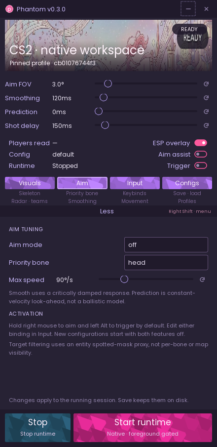
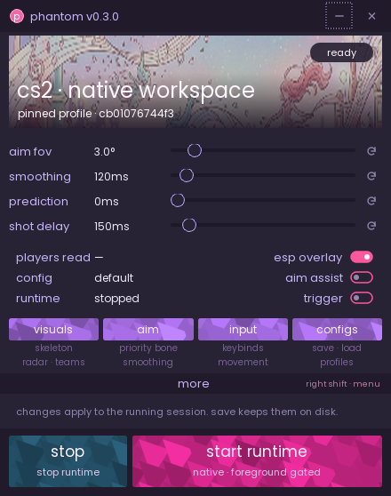

# Phantom native


The selected lavender-and-pink ghost-p logo appears in the native title bar and
window icon. Windows builds also embed a multi-resolution executable icon.
The full-resolution artwork is in `native/assets/phantom-logo.png`.

Standalone **64-bit Windows** external runtime using `ReadProcessMemory`, a click-through GDI overlay, and foreground-gated `SendInput`. No browser, web server, injected DLL, kernel driver, or game-memory writes are used by `phantom.py`.

**This is native implementation code, not a verified complete cheat suite. The Windows build pipeline passes unit tests, Win32 import/ABI checks, and packaged CLI smoke tests. The runtime has not been tested against CS2; passing these checks does not establish live compatibility.** Game updates can invalidate the profile, entity layout, and bone indices independently. Reading or automating a game can result in account bans; no anti-cheat compatibility is claimed.

## Start

Install **64-bit Python 3.11+**. The control panel uses Qt Widgets (PySide6 Essentials); the optional `--headless` runtime remains standard-library only.

```powershell
py -3 -m pip install -r requirements-gui.txt

# Explicit setup: fetch a consistent, commit-pinned a2x/cs2-dumper profile.
py -3 phantom.py --update-offsets

# Open the native control panel. Click Start runtime to attach.
py -3 phantom.py
```

After setup, `start-windows.cmd` opens the same native control panel on Windows. Use `--headless` to run directly without a panel. Use borderless/windowed CS2: the external overlay does not support exclusive fullscreen. After Start is clicked, hide the menu with **Right Shift** to let its separate worker wait for `cs2.exe`; memory access failures or invalid frames suppress drawing/input instead of substituting sample data. Aim and trigger are off in newly created configs.

There is no synthetic fallback in the native runtime. The legacy preview remains in `companion.py`/`web/`, but is not imported or launched by `phantom.py`.

### Supplied offset reference

The supplied [CheatOffsets page](https://www.cheatoffsets.com/g/cs2) listed build **26598758**. A reference profile is included at `native/profiles/reference-26598758.json`. The entity list, local controller, local pawn, view angles, and view matrix module values match that page. The complete required schema/sensitivity fields are extracted from **one** pinned [a2x/cs2-dumper](https://github.com/a2x/cs2-dumper) commit, recorded in the profile; unrelated dumps are not silently mixed.

To explicitly use that reference instead of the downloaded profile:

```powershell
py -3 phantom.py --profile native/profiles/reference-26598758.json
```

The filename identifies the reference page, not a verified compatibility assertion. The runtime does not compare the installed game build to a Steam build ID. It validates structure, pointer reads, local-controller linkage, matrix/vector ranges and scalar ranges; these checks cannot prove every offset correct.

The updater makes three HTTPS requests to GitHub only when explicitly invoked. Normal operation is local/offline. To pin an exact dump revision or import your own files:

```powershell
py -3 phantom.py --update-offsets --ref EXACT_40_CHARACTER_COMMIT_SHA
py -3 phantom.py --import-dumps C:\path\to\dump\output --ref EXACT_40_CHARACTER_COMMIT_SHA
py -3 phantom.py --check-profile
```

`--check-profile` checks file structure only, not the running game. Missing schema fields reject the profile. There is no signature scanner or guessed substitute offset.

## Native control panel

### GUI animation clip

[Watch the 24-second GUI demo (MP4)](docs/demos/gui-demo.mp4).
This records actual offscreen Qt frames on Windows at 30 fps, not a mock-up or
in-game footage. It shows theme/density customization, preset application, aim/ESP
settings, and compact/expanded views. Preset confirmations are auto-accepted by the
demo script only; the normal application always asks before applying a preset. Captions and click rings are annotations; the panel rendering
and animations come from the real widgets. No game worker is started.

To record again with optional developer dependencies:

```sh
python -m pip install -r requirements-gui.txt imageio-ffmpeg==0.6.0
python tools/record_gui.py --output artifacts/gui-demo.mp4
```

The recorder uses temporary config storage and does not save changes to your
normal settings. FFmpeg is supplied by the optional imageio-ffmpeg wheel; it is
not included in the application EXE or required for normal use.

### Screenshots (Poppins)

Actual Qt control-panel captures from the Windows runner, without game access:

| Expanded | Compact |
| --- | --- |
|  |  |

These show the settings panel only, not a live game/overlay capture.

The panel recreates the supplied reference's compact dark-purple layout, pink pill toggles,
outlined sliders, faceted purple tabs, banner, collapsible **More / Less** section, and
cyan/pink action buttons. It uses native Qt Widgets, not HTML, a browser, or WebEngine.
The banner is cropped from the user-supplied reference image; the controls and artwork
buttons are drawn by Qt. Labels and controls are adapted to the implemented CS2 settings,
not the rhythm-game autoplay controls in the reference.

- **Visuals:** skeleton, health/armor bars, teammates, radar, spectators, range.
- **Aim:** mode, priority bone, smoothing, angular FOV with an optional projected ring, speed and linear prediction. The trigger delay can be set from 0–2000 ms. The optional `catalyst` aim mode adapts the movement curve from [Catalyst](https://github.com/nul1ex/catalyst) (commit `2060cede08d8de7af9fc85c93ccb6eb0cd442e2f`) with the repository owner’s permission. It still uses Phantom’s spotted-mask target selection, not Catalyst’s hitbox, visibility, penetration, weapon-state or hitchance systems. Phantom bounds mouse events to 250 counts and does not read scoped FOV sensitivity adjustment; `Max speed` affects the other aim modes, not `catalyst`.
- **Skins:** local client-side weapon skin loadout editor (up to 32 weapons), curated CS2 weapon/paint-kit catalog plus custom paint kit IDs, wear float and condition presets (FN/MW/FT/WW/BS), pattern seed, optional StatTrak counter, custom local nametag, model mesh mode (`auto`/`modern`/`legacy`), live Qt finish preview card, starter skin packs, and `.skin-loadout.json` export for the optional C++ foundation DLL. Local preferences only: `phantom.py` stays read-only and never alters Steam inventory ownership or other players' views.
- **Input:** movement preference and real key/mouse binding capture; Escape cancels.
- **Configs:** validated named save/load and an explicit offset-profile file picker.

Changes are sent to the running native worker over bounded IPC, without blocking the UI.
**Start runtime** saves the active configuration and launches the worker; **Stop** signals
it to clean up its overlay and process handle. Closing the panel also stops its worker,
with a three-second watchdog for an unresponsive process. The panel itself never performs
memory reads or sends game input. Save in Configs keeps edits made while stopped.

The window can be previewed without Windows/game access if Qt and platform libraries are installed:

```sh
python phantom.py --gui --profile native/profiles/reference-26598758.json
QT_QPA_PLATFORM=offscreen python phantom.py --gui --screenshot-dir artifacts/ui --profile native/profiles/reference-26598758.json
```

### v1.2.0 — animated interface

The release version is shown in the title bar, `phantom-native.exe --version`,
and the ZIP's `BUILD.json`. Toggle thumbs and colors ease over 160 ms, facet
buttons ease their hover highlight over 140 ms, and settings pages fade in over
180 ms when switching tabs or expanding. Animations are presentation-only: input
and settings changes are applied immediately. Rapid changes reverse/restart from
the current visual state, and closing the panel stops active animations.

### Interactive skeleton ESP designer

[Watch the full 78-second ESP designer walkthrough](docs/demos/esp-designer-walkthrough.mp4).
It covers all four click/keyboard targets, every output toggle, widths 1–4,
all five real Qt color pickers, sample states, cancel, black-color rejection,
reset, save, and loading/reopening the saved design. Aim remains off and no game
worker starts. Actual Qt window captures are composited with explanatory captions;
Qt (rather than Windows-native) color dialogs are forced only for recording.

To reproduce with the optional `imageio-ffmpeg==0.6.0` capture dependency:

```sh
python tools/record_esp_designer.py --output artifacts/esp-designer-walkthrough.mp4
```


Open **Visuals** or **Aim**, then **open skeleton ESP designer**. The separate
native editor displays a clearly labeled sample actor, never fabricated live
telemetry. Toggle ESP output, skeleton, health/armor bars, bounding box, names,
and distance labels; choose full or cornered bounding boxes and line thickness (1–4) and spotted/unspotted/team,
health and armor colors. The preview and Windows GDI player overlay consume the
same drawing commands. The faded guide and selection dots exist only in the
editor, even if ESP/skeleton output is disabled. Radar and spectator layout are
not represented in this player-style preview.

Click **head, neck, chest, or pelvis**, or focus the preview and press **1–4**, to
set the existing `priority_bone`. Only these four supported targets are selectable;
this does not enable aim assist, change bone indices, or add per-bone visibility.
Preview sample state changes only the specimen, not teammate filtering or range.

Changes use the normal live-settings pipeline. **Save current config** explicitly
writes the active named config (replacing its previous settings); otherwise the
editor's changes remain unsaved. GUI presets also reset the player ESP style to
that preset's defaults. Old native configs without `esp_style` migrate in memory;
other unknown/missing fields remain errors. Pure black is rejected as a style
color because the external GDI overlay reserves it as its transparency key.

The editor is a modal settings window, so the main menu remains visible and its
worker stays paused until it is dismissed. This is not an in-game editor or proof
of live CS2 compatibility.

### Built-in gameplay configuration presets

Open **Configs → built-in presets**, read the description, then click **apply
preset** and confirm. The runtime must be stopped. This replaces feature settings
in memory, but preserves your keybinds, bone map, mouse calibration, and GUI
appearance. It neither starts the runtime nor saves/overwrites any file.
Use **save named config** to keep the result; the name field suggests a new preset
filename. Unknown presets are rejected transactionally.

| Preset | Settings |
| --- | --- |
| defaults | Original defaults; aim, trigger and bunny hop off |
| esp minimal | Health-only ESP, 100 m; skeleton/armor/radar/spectators off; no input automation |
| esp detailed | Skeleton, health, armor, radar and spectators; 250 m; no input automation |
| smooth aim practice | **Enables hold-key smooth aim**: 2° FOV, 200 ms smoothing, 60°/s cap, chest; ESP/radar/spectators off |
| combined practice | **Enables hold-key smooth aim**: 3° FOV, 150 ms smoothing, 75°/s cap, chest; detailed ESP at 150 m |
| trigger practice | **Enables hold-key trigger**, 250 ms delay; health-only ESP at 100 m; aim off |

Prediction and bunny hop are off in every built-in preset. These are editable
starting points, not live-tested, ban-safe, or anti-cheat-compatible profiles.
All existing runtime limitations still apply.

The Windows ZIP includes complete JSON files under `presets/`. To import one,
copy it into your native config directory and load it in Configs. **Those files
contain default keybinds/bone indices/calibration**; unlike GUI Apply, importing a
full JSON replaces those values too. Do not overwrite a personal config unless
that is intended.

[View the presets page](docs/screenshots/gui-presets.png).

### GUI customization

[View the appearance page](docs/screenshots/gui-appearance.png).

Click **appearance** in the title bar (available in compact and expanded modes).
Choose phantom, midnight, forest, or graphite; customize the accent and background
using the native color picker; and select compact or comfortable spacing. Colors
and density preview immediately, including painted toggles, buttons, and icons.
Text/surface colors adapt to the chosen background. The logo and banner artwork
are not recolored.

Choose **interface scale** (80%, 90%, 100%, 110%, 125%, or 150%) and your preferred
compact/expanded startup view, then click **save appearance**. Whole-interface
scaling applies on the next launch, using Qt's high-DPI support; an explicitly
provided `QT_SCALE_FACTOR` environment variable takes priority. Small logical
desktops get workspace scrollbars so controls remain reachable.

Appearance is stored separately in
`%LOCALAPPDATA%/PhantomNative/configs/.ui-preferences.json` (or your custom
`--config-dir`). It is not sent to the worker or changed by loading named gameplay
configs. **reset appearance** previews the defaults; save to persist the reset.
Invalid UI preference files produce a warning and defaults, without overwriting
the file until you explicitly save.

### Layout and typography

The expanded panel uses a horizontal, two-column layout: overview and tabs on the
left, the selected settings page on the right. Longer pages scroll independently.
More/Less switches between the wide view and the compact overview. Interface text
is rendered lowercase in Poppins; stored config names, paths and binding values
are not rewritten.

### Font and menu key

The panel bundles **Poppins Regular** (SIL Open Font License 1.1), registered as
an application font before any UI text is painted. You do not need to install
Poppins. Both Qt widgets and custom-painted captions use the same bundled face;
reset, minimize and close icons are drawn as vectors rather than symbol glyphs.
The package validates required Latin/punctuation glyphs and includes `FONT-LICENSE.txt`.

**Right Shift** shows/hides the menu on Windows, even while the runtime is stopped,
the panel is hidden, or another application has focus. Holding the key does not
repeatedly toggle it. Minimized panels are restored. This requires the panel
process to remain running; `--headless` has no menu. The menu stays on top when open.

To customize it, open **Input → Menu toggle**, click the binding, press the new key
or mouse button, then use **Configs → Save named config**. Escape cancels capture.
Left and right modifiers are distinguished, and conflicting generic/side-specific
modifier bindings are rejected. Capture and modal dialogs suppress menu toggling.
Old version-1 configs without a menu key are upgraded in memory without changing
existing bindings: Right Shift is preferred, then an unused fallback if necessary.
The active binding is always displayed beside More/Less and in Input.

Opening the menu pauses the worker's overlay and game input. Hide/minimize it to
resume, still subject to the foreground-game checks. Stop and emergency exit remain
available while paused. Closing the panel still stops its worker cleanly.

The second command above captures the actual control panel, not a game/overlay screenshot.
Starting the native worker still requires Windows. Opening the panel does not attach to CS2.

## Native implementation scope

| Part | What the code does | Important boundary |
|---|---|---|
| ESP | Decode player controllers/pawns and draw skeletons, health/armor bars, names, distance, team filtering | GDI overlay, not in-game GlowV2. Bones are omitted on failed spatial checks. |
| Colors | Read the local controller's bit in the entity spotted mask | **Not** a map raycast or per-bone visibility check; a spotted actor can still be behind cover. |
| Aim | Hold-key hardlock or critically damped smoothing, selected real bone, angular FOV filter, enemy-only selection | Disabled by default. `SendInput` mouse counts, not silent aim. Hardlock still has a speed cap. No randomizers. |
| Prediction | Optional constant-velocity look-ahead in milliseconds | Not a latency/ballistic/server-tick model. |
| Trigger | Crosshair entity lookup, enemy/spotted checks, stable-target delay and repeated-shot cooldown | Disabled by default. No weapon readiness, ammo or fire-rate model. |
| Bunny hop | Optional grounded transition → Space press/release | Disabled by default. No server compatibility guarantee. |
| Radar | Player-centered circular radar rotated by local yaw | No map texture, parsing, or height-layer model. |
| Spectators | Resolve observer services/target handles back to the local pawn | Only actors resolvable from the sampled entity list. |
| Configs/hotkeys | Named atomic JSON configs; configurable Windows virtual-key bindings; live reload/save | Native Qt control panel with live settings; separate from legacy browser configs. |

**Not implemented:** silent aim, map parsing, per-bone visible fallback, anti-recoil, in-game GlowV2, sound ESP, bomb/defuse countdowns, grenade lineups, POV changes, no-spread, no-flash, no-smoke, third person, bullet tracers, hitmarkers, and an in-game visual-layout/bone editor. A sample-only external ESP designer is available as described below. The panel edits implemented ESP preferences. Unsupported settings are rejected rather than offered as nonfunctional switches. No FliXxCZ code is included or implied.

## Controls and configurations

Runtime bindings apply while CS2 is foreground, except **End**, which exits the worker globally. The panel's menu key works independently of the worker:

| Binding | Action |
|---|---|
| Right Shift | Show/hide menu (rebindable in Input) |
| F5 | Radar on/off |
| F6 | ESP on/off |
| F7 | Toggle aim off / the configured mode (smooth if no mode selected) |
| Hold right mouse | Aim activation when aim is enabled |
| F8 | Trigger on/off |
| Hold left Alt | Trigger activation when enabled |
| Hold Space | Bunny hop when enabled in config |
| F9 | Reload the selected named config |
| F10 | Save current settings to that config |
| End | Exit |

Config location: `%LOCALAPPDATA%\PhantomNative\configs\NAME.json`. Profile: `%LOCALAPPDATA%\PhantomNative\offset-profile.json`.

```powershell
py -3 phantom.py --config practice --init-config
py -3 phantom.py --list-configs
py -3 phantom.py --config practice
```

Use the control panel, or edit a native JSON config in a text editor and press F9 while the runtime is active to reload. `aim` accepts `off`, `smooth`, or `hardlock`; `priority_bone` accepts `head`, `neck`, `chest`, or `pelvis`. `prediction_ms` defaults to zero. `keys` contains numeric Windows virtual-key codes. `bones` contains configurable model-specific bone indices. There is no automatic model skeleton discovery.

Mouse conversion assumes the configured `mouse_yaw` and `mouse_pitch` (both default 0.022), the memory-read sensitivity, and ordinary mouse input. Scoped sensitivity, game input settings, Windows mouse acceleration, or blocked synthetic input can make it inaccurate. Foreground is checked before sampling and again before emitting input; no global aim/fire loop is allowed to run against another foreground process.

Entity chunk parameters and candidate strides live in the profile's `layout` block. The stride must resolve the local controller's pawn handle to the actual local pawn **uniquely**. The skeleton-array pointer location and bone stride remain explicit build-dependent assumptions. Invalid/unreadable bones produce no skeleton or aim target.

## Optional executable

On Windows:

```powershell
py -3 -m pip install pyinstaller -r requirements-gui.txt
build-native.cmd
```

This produces the windowed GUI executable `dist\phantom-native.exe`. Run `phantom-native.exe --update-offsets` before normal launch. The GitHub Windows package pipeline also produces an executable with CLI smoke checks. Config/profile files stay outside the executable; live gameplay remains unverified.

## C++ internal foundation

An x64 C++ DLL is included as a tested foundation for the requested internal rewrite. Build it with:

```powershell
cmake -S cpp -B build-cpp -A x64
cmake --build build-cpp --config Release
ctest --test-dir build-cpp -C Release --output-on-failure
```

The DLL exports a C ABI for bomb-timer evaluation, an experimental Windows-only in-process bomb reader, an opt-in transparent Poppins timer overlay, and an experimental local-only skin changer (`MemoryCosmeticAdapter` + `CosmeticController` + `phantom_runtime_*_skin*`). Loading the DLL alone does not read, write, or draw anything; a host must call the runtime API explicitly. Both readers/adapters use the pinned `a2x/cs2-dumper` build profile and fail closed on unreadable data, recycled handles, or non-local weapons (`phantom_apply_cosmetics()` returns `PHANTOM_NOT_INTEGRATED` outside CS2). Coverage is fabricated-memory only and has not been validated in live CS2. There is no DLL injector, anti-cheat bypass, or inventory ownership change. Use `phantom.py --export-skins` or **Skins → Sync `.skin-loadout.json`** to export local loadouts for the C++ foundation. See [cpp/README.md](cpp/README.md) and never treat CI checks as CS2 compatibility proof.

## Tests

```sh
python -m unittest discover -s tests -v
python -m compileall -q native phantom.py
```

The native suite exercises a sparse fabricated-memory fixture through entity traversal, stride calibration, schema decoding, skeleton rejection, local spotted-mask selection, target filters, SmoothDamp convergence, input math, prediction, trigger delay/cooldown, grounded transitions, strict configs, and CLI setup. These fixtures are test-only; they are not telemetry used by the runtime. Existing legacy API tests remain intact. Win32 imports/INPUT ABI are checked by Windows CI. Overlay rendering, actual memory reads, synthetic-input acceptance, process offsets, and gameplay behavior still require Windows/CS2 testing.

### Downloadable Windows ZIP

The **Windows package** GitHub Actions workflow builds on a Windows x64 runner,
checks Win32 imports/ABI, tests actual Qt controls, smoke-tests the executable and
captures its compact/expanded control panel, then uploads a
`phantom-windows-x64` artifact, downloadable as a ZIP with the files at its root (no nested ZIP).
The ZIP contains the EXE, pinned reference profile, a `run.cmd` launcher,
configuration example, instructions, actual control-panel screenshots, `phantom-cpp/` (the tested C++ foundation DLL, header and status document), and a source revision/EXE/DLL SHA-256 manifest.
Extract the complete ZIP and double-click `run.cmd`; Python is not required.
The DLL includes experimental opt-in bomb-timer and local skin-changer runtime adapters, neither of which is live-game validated.
A successful package build is not a live-game compatibility test.
